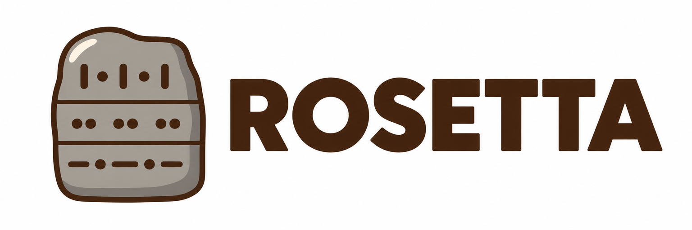

# ROSETTA

The translation service of the Eastern Province: Sinhala, Tamil and English translation that every provincial system uses, with one shared glossary. Machine output is a draft for a person to check, never an official text.

**Why the name.** Named after the Rosetta Stone, which carries the same text in three scripts.

## Contributing

Anyone can help: research, testing, documents and code. **Work is not assigned: pick an issue or open one, and take it to the end.** Questions go in the issue they are about. Contributions are tracked through this repository (issues, pull requests, commits and reviews).

- [CONTRIBUTING.md](CONTRIBUTING.md): how work happens here
- [docs/GETTING-STARTED.md](docs/GETTING-STARTED.md): first time on GitHub, step by step
- [docs/RESEARCH.md](docs/RESEARCH.md): what we are researching first
- [CODE_OF_CONDUCT.md](CODE_OF_CONDUCT.md) · [SECURITY.md](SECURITY.md)

## Licence

[MIT](LICENSE)
