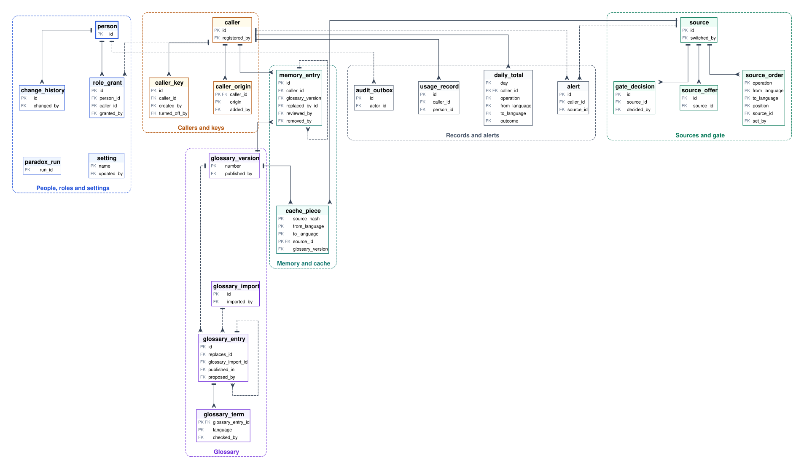
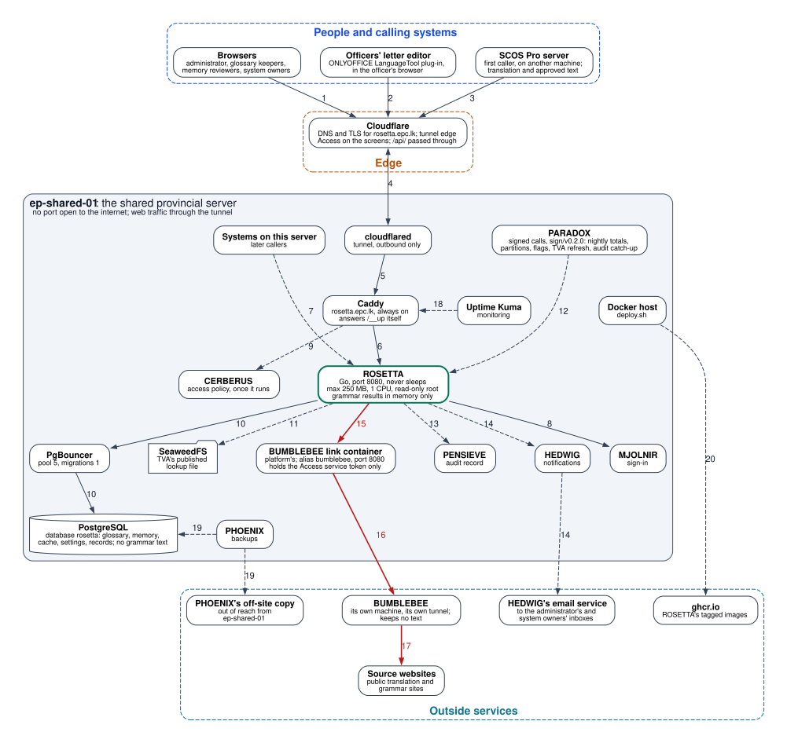

# ROSETTA

The translation and grammar service of the Eastern Province, Sri Lanka: the one way every provincial system translates and checks text in Sinhala, Tamil and English, with one shared glossary.
Version 1.0, frozen. Owner: the Office of the Chief Secretary, Eastern Province. Address: rosetta.epc.lk.

## 1. Overview

Every citizen-facing provincial service must work in Sinhala, Tamil and English. If each system finds its own way to translate and check grammar, the same official term comes out differently in each, failures are hidden in different ways, and no one can move all systems to a better translator at once.

ROSETTA is one always-on service that every provincial system calls for language work. Its first caller is the provincial letter editor (SCOS Pro), which translates letters and checks their English. It contains:

- registration of calling systems, each with its own key;
- translation of a list of passages, all or nothing, between Sinhala, Tamil and English;
- English grammar and spelling checks, which the editor's checking plug-in uses unchanged;
- one shared glossary of official terms, kept by a named keeper for each language;
- a shared memory of translations a person has approved in a calling system;
- browser sources reached through BUMBLEBEE, chosen by order, with fallback;
- masking of identity card and phone numbers before text leaves the shared server;
- a language gate, so a direction is used by machine only after it passes evaluation;
- usage records without text, and screens for the administrator, the glossary keepers and system owners.

**How it works.** A system sends a list of passages with its key, the source and target languages and how sensitive the text is. ROSETTA splits each passage into sentences and answers each from the glossary, the memory or the cache where it can. It masks identity card and phone numbers in the rest, sends it to the first working BUMBLEBEE source in order, puts glossary terms and masked values back, and returns every passage with its sources and the label "Machine translation, check before issue", or one error if any passage failed. A person checks and approves the text in the calling system, which may send the approved text back to join the memory. Grammar checks come from the officer's editor, follow the same masking and fallback, and return suggestions; their text is never stored. Later providers, such as the models volunteers are researching, join behind ROSETTA and callers change nothing.

The name comes from the Rosetta Stone, which carries the same text in three scripts.

**Not included:** model providers and routing through JARVIS (later), approval of translations (each calling system's own), long-text jobs and file translation, language detection, writing names in another script, legacy font conversion, Sinhala and Tamil grammar (later), speech, browser work (BUMBLEBEE), terms of use of outside sites (managed by the Office outside the systems), prices.

Values marked "(default: ...)" are settings the Office can change.

## 2. Stakeholders

| Stakeholder | Role in ROSETTA |
|---|---|
| The Office of the Chief Secretary | Owns ROSETTA and its data. **Administrator**: registers calling systems and issues their keys, sets the source order and the language gate, changes settings, names glossary keepers and memory reviewers, grants roles |
| Officers fluent in Sinhala, Tamil or English, named by the Office | **Glossary keeper** for one language: approves, corrects and replaces terms in that language (R-GLO). **Memory reviewer** for one language: rechecks and removes memory entries (R-MEM-04, R-MEM-05) |
| Owner of a calling system (an officer) | **System owner** for their own systems: sees their usage and errors, issues and turns off their system's keys, sends test requests, receives alerts about their systems |
| Officers using a calling system | Translate letters and check their English through that system, and approve translations there under its own rules; any officer may propose a glossary term (R-GLO-04) |
| Calling systems (the letter editor first) | Call ROSETTA with their key; never call BUMBLEBEE or a model directly. Each decides what it sends, marks its sensitivity, keeps its own approval record, and answers for what it issues |
| Volunteers and maintainers | Research and test models that may become providers, and run the shared test set for the gate; run the shared server; never see real text |

Every role is held by a personal account signed in through MJOLNIR, the provincial sign-in. A system owner's powers cover only their own systems. The glossary, memory, settings and records belong to the Office, never to a person or a calling system. When a person moves, their roles end on the effective date and records keep the post they held at the time. A calling system left without an owner, or a language left without a glossary keeper, is flagged to the administrator.

## 3. Functional requirements

### 3.1 Calling systems and keys (R-CAL)

| ID | Requirement |
|---|---|
| R-CAL-01 | A system can be registered as a caller only if it has a live entry in the provincial system register (TVA). ROSETTA checks the entry when the system is registered and records its reference. |
| R-CAL-02 | Each calling system has one named owner. A system whose owner's role ends is flagged to the administrator (R-ADM-03). |
| R-CAL-03 | The administrator, or the system owner for their own system, issues a key for a calling system and can turn it off at once. The key is shown once and can never be shown again. A system may hold two live keys at a time, so a key can be replaced without stopping. |
| R-CAL-04 | A request with no key, an unknown key or a turned-off key is refused with the reason "no key" (R-ERR-01) and counted on the status screen (R-ADM-02). |
| R-CAL-05 | A calling system that has sent no request for 90 days (default: 90 days), or whose register entry is no longer live, is flagged to the administrator. |
| R-CAL-06 | An officer's browser may call the grammar check (R-GRM-01) directly, only while the officer is signed in, and only from addresses the administrator lists for that calling system (default: the letter editor's address). The call is counted to that system. |
| R-CAL-07 | Each calling system has limits: requests a minute (default: 60) and requests at once (default: 5). A request over a limit is refused with the reason "over limit" and when to try again. |

### 3.2 Translation (R-TRN)

| ID | Requirement |
|---|---|
| R-TRN-01 | A system sends a list of up to 200 passages (default: 200), each up to 5,000 characters and at most 20,000 characters in all (default: 20,000), with the source and target languages, and receives the same number of passages back, in the same order, in the same request. The languages are Sinhala, Tamil and English, named by the caller; all six directions are offered, each under its own gate (R-GAT). |
| R-TRN-02 | A request is all or nothing: if any passage cannot be translated, the whole request fails with that passage's position and reason, and no passages are returned. |
| R-TRN-03 | Every request states the sensitivity of its text: ordinary, personal or confidential (R-MSK-01). There is no default; a request without it, or naming any other language, is refused with the reason "invalid request". |
| R-TRN-04 | ROSETTA splits each passage into sentences, and longer sentences at word boundaries, and answers each piece in this order: a whole glossary term (served under any gate state), the memory (R-MEM-02), the cache (R-TRN-08), then a source (R-PRV-02). Each passage is the pieces joined in their original order, with line breaks and spacing at its edges kept. |
| R-TRN-05 | Sending the same request again gives the same answer while the glossary, memory and cache are unchanged, so a caller may retry safely. |
| R-TRN-06 | Every answer states, for each passage: where its pieces came from (glossary, memory, cache or source), the source and its version, whether a machine produced any of it, and the glossary version used. The answer carries the request reference. |
| R-TRN-07 | Every passage that a machine produced in whole or part carries the label "Machine translation, check before issue" in all three languages, for the caller to show beside the text. Passages wholly from the glossary or memory carry no label and are marked as checked by a person. |
| R-TRN-08 | Each translated piece of ordinary text is kept in a cache for 30 days (default: 30 days), by text, language pair and source, so the same piece is not sent to a source twice. Personal and confidential text is never cached. A glossary change removes cached pieces that hold the changed term (R-GLO-06). |
| R-TRN-09 | ROSETTA never returns the original text, or part of it, as if it were the translation. |

### 3.3 Grammar and spelling checks (R-GRM)

| ID | Requirement |
|---|---|
| R-GRM-01 | ROSETTA answers grammar checks in the form the editor's existing checking plug-in expects, including its list of languages, so the plug-in works unchanged once pointed at ROSETTA. Other systems may call the same check with their key. |
| R-GRM-02 | A check sends English text of up to 20,000 characters (default: 20,000) and receives a list of suggestions, or an empty list when there is nothing to suggest. ROSETTA splits longer text into pieces of at most 5,000 characters for its sources and joins their suggestions. Sinhala and Tamil are listed as not offered and refused with the reason "unsupported". |
| R-GRM-03 | Each suggestion gives its start and length in the units the editor counts (UTF-16), a message, up to 3 replacements, a category (for example spelling, grammar or style) and the source that made it. Positions always refer to the text the caller sent, also after masking (R-MSK-02) and splitting. |
| R-GRM-04 | Suggestions on a glossary term are dropped, so approved names, posts and offices are never marked as errors. |
| R-GRM-05 | Grammar text is never written to disk, a record or the cache. To spare sources, the suggestions for an identical text are held in memory for 10 minutes (default: 10 minutes) and then forgotten. |
| R-GRM-06 | Grammar sources are tried in order of their English benchmark score, as BUMBLEBEE publishes it (R-PRV-01), unless the administrator sets another order. |

### 3.4 Sources and fallback (R-PRV)

| ID | Requirement |
|---|---|
| R-PRV-01 | BUMBLEBEE is ROSETTA's only provider. ROSETTA uses BUMBLEBEE's list of browser sources, never older than 60 seconds (default: 60 seconds), with each source's operations, languages, state, resume time, and grammar benchmark score, and skips paused sources until their resume time. A new provider joins later behind the same requests, with no change in any caller. |
| R-PRV-02 | For translation in each direction and for grammar, the administrator sets the order of sources and can turn a source off for ROSETTA. ROSETTA sends each piece to the first source in order that is on, open under the gate (R-GAT) and allowed for the text's sensitivity (R-MSK-01). |
| R-PRV-03 | A source call that fails (unavailable, busy, blocked, page changed, timed out, too long, unsupported or turned off) goes to the next source in order. On "busy" with a suggested wait shorter than the time left, ROSETTA waits and tries the same source once more first. The answer says that fallback was used. |
| R-PRV-04 | ROSETTA sends each source call at most 5,000 characters, waits at most 60 seconds for it (default: 60 seconds) and keeps each source under its limit of calls a minute (default: 30 a minute). |
| R-PRV-05 | ROSETTA never tries to get round a block, a bot check or a sign-in wall. It respects every "try again after" a source gives. |
| R-PRV-06 | If every allowed source fails, the request fails with the reason "no provider" and the earliest time a source is expected back (R-TRN-09). |

### 3.5 Sensitivity and masking (R-MSK)

| ID | Requirement |
|---|---|
| R-MSK-01 | **Ordinary** text may go to any source. **Personal** text, which holds names, addresses or similar, may go to any source after masking (R-MSK-02), but is never cached, never kept in memory and never kept after the answer. **Confidential** text goes only to providers on provincial machines; as there are none yet, it is refused with the reason "no provincial provider". |
| R-MSK-02 | Before any text, translation or grammar, leaves the shared server, ROSETTA replaces identity card numbers (old and new forms) and phone numbers with stand-ins, whatever the declared sensitivity. Calling systems need not mask them first. Masking is a help, not a guarantee: anything it does not recognise is sent as written. |
| R-MSK-03 | Stand-ins in the source's answer are replaced with the original values before the answer goes back. A stand-in the source lost or changed makes that piece fail with the reason "masking lost", never an answer without the value. The link between stand-ins and original values exists only while the request runs and is never stored or written to any record. |
| R-MSK-04 | Text marked ordinary that holds an identity card number is treated as personal, and the mismatch is counted for the system owner (R-REC-03). |

### 3.6 Glossary (R-GLO)

| ID | Requirement |
|---|---|
| R-GLO-01 | There is one shared glossary for the province. Each entry holds the same term in Sinhala, Tamil and English, its type (post, institution, place, term, or "keep as written" such as system names and reference formats), a note, and the keeper who checked each language. |
| R-GLO-02 | An entry is published only when all three languages are checked by their keepers. A term with only two checked is held. Entries are never deleted, only replaced; a replaced entry keeps its history. |
| R-GLO-03 | Every glossary term found in a text appears in the translation as its published translation. ROSETTA protects the terms before sending the text and checks them in the answer; a term the source changed or dropped is put back, and if it cannot be placed the passage flags it for the reader. "Keep as written" entries are never translated. |
| R-GLO-04 | Any signed-in officer may propose a new or corrected term on the screens. The keepers for the languages concerned are told, and the proposer sees the outcome. |
| R-GLO-05 | The glossary has one version number, which goes up by one with every published change. Every translation records the version it used, and any past version can be read on the screens, so a letter can be checked against the glossary it was written with. |
| R-GLO-06 | A published change removes cached pieces that hold the changed term (R-TRN-08) and marks memory entries that hold it for recheck (R-MEM-04). |
| R-GLO-07 | The administrator can import entries from a spreadsheet file of up to 5,000 rows (default: 5,000) and export the glossary as one. Imported entries wait as proposals for the keepers (R-GLO-02). |

### 3.7 Translation memory (R-MEM)

| ID | Requirement |
|---|---|
| R-MEM-01 | A calling system may send ROSETTA ordinary text that a person approved in that system: each source passage with its approved translation, the languages and the approver's post. Approval itself stays in the calling system, whose record is the authoritative one. |
| R-MEM-02 | Each approved passage is split into pieces as in R-TRN-04 and joins the shared memory with the approver's post, the calling system, the date and the glossary version. Memory serves every calling system and is kept until replaced; a newer approval of the same source piece replaces the older one. |
| R-MEM-03 | Personal and confidential text sent for memory is refused with the reason "invalid request" and never kept. |
| R-MEM-04 | Memory entries marked for recheck (R-GLO-06) are not served until a memory reviewer for that language confirms, corrects or removes them on the screens. |
| R-MEM-05 | The administrator, or a memory reviewer for their language, can find memory entries by text and remove a wrong one. Removal is recorded (R-REC-02). |

### 3.8 Language gate (R-GAT)

| ID | Requirement |
|---|---|
| R-GAT-01 | Each translation direction is open or closed for each source. The administrator opens it only after recording the evaluation it rests on: the shared test set, the score and the source version. A new source version starts closed. |
| R-GAT-02 | The glossary and the memory are checked by people, not machines, and are served whatever the gate state. |
| R-GAT-03 | A request whose pieces need a source in a direction closed for every allowed source is refused with the reason "human translation required", with any glossary terms found in the text to help the translator. |
| R-GAT-04 | Systems can read each direction's gate state, the sources open for it and the date of its evaluation, so a closed direction can offer human translation instead of a broken button. |

### 3.9 Errors (R-ERR)

| ID | Requirement |
|---|---|
| R-ERR-01 | Every refusal or failure gives one reason from a fixed list (no key, over limit, invalid request, too long, unsupported, human translation required, no provincial provider, masking lost, no provider, timed out) and, where it helps, when to try again. An error never holds the text that was sent. |
| R-ERR-02 | Every reason comes with a message for the officer in Sinhala, Tamil and English, so the caller can show it in the reader's language. These messages are approved texts in the memory. |
| R-ERR-03 | A request that runs longer than 60 seconds in all (default: 60 seconds) stops with the reason "timed out"; the caller may send it again (R-TRN-05). |

### 3.10 Records (R-REC)

| ID | Requirement |
|---|---|
| R-REC-01 | Every request leaves a usage record: calling system, officer (if signed in), operation, sensitivity, languages, passages and length, pieces by origin (glossary, memory, cache, source), sources used, fallback used, time taken, outcome or reason and request reference. It never holds the text or the answer. ROSETTA passes the request reference to every source call, so BUMBLEBEE's own records can be matched to ROSETTA's. |
| R-REC-02 | Glossary changes, memory additions and removals, gate changes, source order and state changes, key changes and setting changes are sent to the provincial audit record (PENSIEVE) with who, what and when, never text. |
| R-REC-03 | Usage screens show requests, pieces by origin, failures by reason, sensitivity mismatches (R-MSK-04) and time taken, by calling system, operation, direction, source and day. A system owner sees only their own systems. Any view can be exported as a spreadsheet file. |
| R-REC-04 | Each night, usage records are added to daily totals. Usage records are removed after 2 years (default: 2 years); daily totals after 5 years (default: 5 years). |

### 3.11 Administration (R-ADM)

| ID | Requirement |
|---|---|
| R-ADM-01 | The screens are open only to named people with a role (R-ADM-06). Calling systems never use the screens. |
| R-ADM-02 | A status screen shows BUMBLEBEE up or down, each source's state and resume time, and today's requests, refusals and failures by reason. |
| R-ADM-03 | The administrator is alerted by email when BUMBLEBEE stops answering, when a source is paused or resumes, when every source for a direction or for grammar is unavailable, when failures for one system pass 20 percent in an hour (default: 20 percent), and when a system or language is flagged (R-CAL-02, R-CAL-05). A system owner gets the alerts about their own systems. |
| R-ADM-04 | A system owner or the administrator can send a test request with invented text from the screens and see the full answer, including sources and fallback. |
| R-ADM-05 | Every change to a setting, source order, gate or key is kept as history with who made it and when, and takes effect within 60 seconds with no change in any calling system. |
| R-ADM-06 | The administrator grants and ends the roles of administrator, glossary keeper and memory reviewer (each for one language) and system owner. Each role has an end date or none; ending a role takes effect at once. |
| R-ADM-07 | Changes to how systems call ROSETTA only add to what exists. A change that would break a caller runs beside the old way for at least 6 months (default: 6 months), and every system owner is told. |

## 4. Non-functional requirements

| ID | Requirement |
|---|---|
| R-NFR-01 | **Capacity:** up to 30 calling systems; 3,000 requests an hour, with up to 300 source calls an hour and 30 a minute at peak; a glossary of 20,000 entries and a memory of 500,000 pieces. |
| R-NFR-02 | **Speed:** answers wholly from the glossary, memory or cache in under 1 second for 95 percent of requests. A 500-character translation or grammar check through a browser source typically in 2 to 6 seconds; ROSETTA adds no more than 0.5 seconds to a source's time. Screens load in under 2 seconds. |
| R-NFR-03 | **Weak connections:** screens work on a 1 Mbps connection; each page is under 200 KB after its first load and needs no large script. |
| R-NFR-04 | **Devices:** screens work on current Chrome, Edge and Firefox on office computers and on phones from 360 pixels wide. |
| R-NFR-05 | **Languages:** screens and messages in Sinhala, Tamil and English, chosen by the user and remembered. All text is Unicode, normalised the same way before it is compared or stored, so the same word is always matched. Every answer names the language of its text, for screen readers. |
| R-NFR-06 | **Accessibility:** screens meet WCAG 2.2 level AA. |
| R-NFR-07 | **Availability:** ROSETTA is always on and never sleeps. If it stops answering, the administrator is alerted within 5 minutes by the platform monitor, which does not depend on ROSETTA or the email service. |
| R-NFR-08 | **Recovery:** the glossary, memory, cache, settings, keys and records are backed up nightly and can be restored to any moment. Requests in progress during a restart fail with a reason and may be sent again (R-TRN-05). |
| R-NFR-09 | **Continuity:** while BUMBLEBEE or every source for a direction is down, the glossary and memory still answer, and every other request fails at once with its reason; callers must keep working without machine translation. |
| R-NFR-10 | **Security:** keys are stored so they cannot be read back; all traffic is encrypted; ROSETTA's own credentials for BUMBLEBEE live only on the server, never in the repository or on the screens; browser calls are accepted only from listed addresses (R-CAL-06); every request to the screens passes the provincial access policy (CERBERUS) once it runs. |
| R-NFR-11 | **Privacy (Personal Data Protection Act, No. 9 of 2022):** each calling system decides what it sends and marks its sensitivity, and answers for that under the Act. ROSETTA keeps no grammar text (R-GRM-05), never keeps personal or confidential text after the answer (R-MSK-01), masks identity card and phone numbers before text leaves the shared server (R-MSK-02), and keeps no text in records (R-REC-01). Screens load no analytics, trackers or outside fonts. Development and evaluation use invented text only. |
| R-NFR-12 | **Retention:** cache 30 days (R-TRN-08); grammar results 10 minutes in memory (R-GRM-05); memory and glossary until replaced; usage records 2 years and totals 5 years (R-REC-04). |
| R-NFR-13 | **Third-party privacy:** an outside site used as a browser source receives the text, after masking, and keeps or uses it under that site's own terms, not ROSETTA's. Every BUMBLEBEE source is an outside public website, and the screens say so beside each source, so the Office and system owners can choose. |
| R-NFR-14 | **Maintainability:** one small program. A later provider joins with one adapter and settings, and no change in callers. Development runs with one command, with a stand-in BUMBLEBEE and a stand-in email service, and the volunteers' shared test set can be run against any source to produce the evaluation the gate needs (R-GAT-01). |

## 5. Technology stack

| Part | Choice |
|---|---|
| Service | Go, one small program on ep-shared-01 under the ALLSPARK STACK; always on (an exception the user approved, joining the platform network as a shared service like JARVIS); memory cap 250 MB, Go memory target 200 MB, 1 CPU; logs 3 files of 10 MB; read-only root filesystem; a `-healthcheck` flag that exits 0 when healthy |
| Data | Database `rosetta` in the shared PostgreSQL through PgBouncer (pool 5, migrations pool 1) for glossary, memory, cache, settings and records; `pg_trgm` text search to find pieces holding a changed term; translation cache in an `UNLOGGED` table (may be empty after a crash or restore); usage records in monthly partitions; grammar results in process memory only; no cache server |
| Translation API | HTTPS JSON, versioned, server to server; callers on ep-shared-01 call ROSETTA directly on the platform network; callers on other machines (SCOS Pro) through Cloudflare to `/api/` only, with signed requests and their key; keys stored hashed |
| Grammar API | LanguageTool-compatible check and languages endpoints, so the editor's ONLYOFFICE LanguageTool plug-in works unchanged; called from the officer's browser with MJOLNIR sign-in, CORS only for the listed editor addresses; separate from the server-to-server path |
| Browser sources | BUMBLEBEE on its own machine, reached only through its Cloudflare tunnel from a link container on ep-shared-01 with an Access service token, plus ROSETTA's own key; synchronous calls of at most 5,000 characters; BUMBLEBEE keeps no text |
| Schedules | PARADOX, contract `sign/v0.2.0` (`apps/rosetta/schedules.yaml`, `paradox.pub`): nightly totals and removals, next months' record partitions, daily flags and TVA refresh, audit entries waiting for PENSIEVE; each call signed and checked |
| Screens and sign-in | Go templates and htmx; MJOLNIR (OpenID Connect); Cloudflare Access in front of rosetta.epc.lk screens; CERBERUS checked by Caddy once it runs |
| Links to other services | TVA's published register file read from SeaweedFS with a read-only key; PENSIEVE for audit entries; HEDWIG for alert email |
| Operations | Uptime Kuma on `/__up` and a container monitor; one env file for secrets on the server, `.example` only in the repository; PHOENIX nightly backup of the database; Docker Compose with a stand-in BUMBLEBEE for development; GitHub Actions builds tagged images to GHCR; `deploy.sh` |

## Annex A: Entity relationship diagram

Boxes show each entity's keys; the other fields are in A.2. Lines point from a table up to the table it refers to (crow's foot: many; bar: one; dashed: optional). Every `person_id`, `actor_id` and `*_by` field refers to `person`; only the main links to it are drawn. `caller` and `source` are the centres of the working data. Grammar text, masking stand-ins and test requests are never stored, so no table holds them. This page is A3; zoom in to read.

### A.1 Storage and loss

Everything is kept in the database `rosetta` on the shared server and backed up nightly by PHOENIX, with point-in-time restore (R-NFR-08). The translation cache is the exception: it may be empty after a crash or a restore from change logs, and refills as requests arrive (R-TRN-08). People are kept as MJOLNIR sent them; posts are not held by any system yet, so an approver's post is the text the calling system sent. A caller's name is a display copy, refreshed daily from TVA's published file. Usage records are kept in monthly parts, so the oldest month is dropped whole after 2 years (R-REC-04).

### A.2 Data dictionary

<!-- dictionary:start -->
#### A.2.1 People, roles and settings

| Entity | Fields |
|---|---|
| `person` | `mjolnir_subject`: text, unique; the person's MJOLNIR account ID; `name, email`: text, as MJOLNIR sent them at the last sign-in; `screen_language`: si, ta or en; chosen on the screens and remembered (R-NFR-05); `first_seen_at, last_seen_at`: time (UTC) |
| `role_grant` | `role`: administrator, glossary keeper, memory reviewer or system owner (R-ADM-06); `language`: si, ta or en; glossary keeper and memory reviewer only; `caller_id`: system owner only; at most one live system owner per caller (R-CAL-02); `starts_at, ends_on`: time (UTC); date or empty for no end date; `ended_at, ended_by`: time (UTC); person; ending takes effect at once |
| `setting` | `value`: text; every "(default: ...)" value in the PRD; `updated_at`: time (UTC); takes effect within 60 seconds (R-ADM-05) |
| `change_history` | `subject`: setting, source order or source switch (R-ADM-05); `subject_ref`: text; the setting name, or the operation and direction; `old_value, new_value`: text; never text sent by a caller; `changed_at`: time (UTC) |
| `paradox_run` | `job`: nightly totals and removals, monthly record parts, daily flags, TVA refresh or audit catch-up; `started_at, finished_at`: time (UTC); a run_id already here is skipped; `kept`: 90 days |

#### A.2.2 Callers and keys

| Entity | Fields |
|---|---|
| `caller` | `tva_reference`: text, unique; the system's entry in TVA (R-CAL-01); `name`: text (max 200); display copy, refreshed daily from TVA's published file; `tva_live, tva_checked_at`: yes/no; time (UTC); a caller not live is refused; `requests_per_minute`: number (default: 60) (R-CAL-07); `requests_at_once`: number (default: 5); `registered_at, last_request_at`: time (UTC); `flag`: none, no owner, idle 90 days or not live in TVA (R-CAL-02, R-CAL-05) |
| `caller_key` | `key_hash`: one-way hash; the key itself is shown once (R-CAL-03); `prefix`: first characters, shown in lists; `created_at, last_used_at`: time (UTC); `turned_off_at`: time (UTC); empty while live; at most 2 live per caller |
| `caller_origin` | `origin`: browser address allowed to call the grammar check, for example the letter editor's (R-CAL-06); `added_at`: time (UTC) |

#### A.2.3 Sources and gate

| Entity | Fields |
|---|---|
| `source` | `name`: text, unique, as in BUMBLEBEE's list, for example google-translate; `version`: text; BUMBLEBEE's part for this site, returned with every answer; `state`: on, resting after a block, resting after a page change, or off; `rest_until`: time (UTC); empty unless resting; skipped until then (R-PRV-01); `on_for_rosetta`: yes/no; the administrator can turn a source off (R-PRV-02); `switched_at`: time (UTC); `seen_at`: time (UTC); last refresh of the list, never older than 60 seconds; `processes_text`: always an outside public website for BUMBLEBEE sources |
| `source_offer` | `operation`: translate or grammar check; `from_language`: si, ta or en; `to_language`: si, ta or en; translation only, never the same as from_language; `benchmark_score`: grammar only; found share less false-alarm share, from BUMBLEBEE's latest run (R-GRM-06) |
| `source_order` | `operation`: translate or grammar check; `to_language`: si, ta or en; for grammar the same as from_language; `position`: number from 1; grammar follows benchmark score unless set (R-GRM-06); `set_at`: time (UTC) |
| `gate_decision` | `from_language, to_language`: si, ta or en; `source_version`: text; a new version starts closed (R-GAT-01); `state`: open or closed; `test_set_version, score`: text; number; the evaluation it rests on; `evaluated_on`: date; `effective_from, effective_to`: time (UTC); empty to while current; history kept |

#### A.2.4 Glossary

| Entity | Fields |
|---|---|
| `glossary_entry` | `type`: post, institution, place, term, or "keep as written" (R-GLO-01); `note`: text (max 500); `status`: proposed, held (not all three checked), published, replaced or refused (R-GLO-02); never deleted; `proposed_at`: time (UTC); `outcome_note`: text; shown to the proposer (R-GLO-04); `replaced_in`: glossary version number; empty while current |
| `glossary_term` | `language`: si, ta or en; `text`: text (max 500), Unicode, normalised; `checked_at`: time (UTC); empty until the keeper for the language checks it |
| `glossary_version` | `published_at`: time (UTC); one number for the whole list (R-GLO-05); `summary`: entries added and replaced |
| `glossary_import` | `file_name`: text; spreadsheet of up to 5,000 rows (R-GLO-07); `rows, accepted, refused`: numbers; `imported_at`: time (UTC) |

#### A.2.5 Memory and cache

| Entity | Fields |
|---|---|
| `memory_entry` | `from_language, to_language`: si, ta or en; `source_text, source_hash`: text, normalised; hash for look-up, ordinary text only; `approved_text`: text; approved in the calling system (R-MEM-01); `approver_post`: text, as the calling system sent it; `approved_on`: date; `state`: served, recheck, removed or replaced (R-MEM-02, R-MEM-04); found for recheck by text search; `added_at, reviewed_at, removed_at`: time (UTC); `kept`: until replaced or removed |
| `cache_piece` | `source_text, translation`: text; ordinary text only, never personal (R-TRN-08); `source_version`: text; `created_at, expires_at`: time (UTC); 30 days; `kept`: 30 days; may be empty after a crash or a restore, then rebuilt |

#### A.2.6 Records and alerts

| Entity | Fields |
|---|---|
| `usage_record` | `request_ref`: text, unique; passed to every BUMBLEBEE call (R-REC-01); `at`: time (UTC); `operation`: translate, grammar check, memory add or test; `sensitivity`: ordinary, personal or confidential; `from_language, to_language`: si, ta or en; `passages, characters`: numbers; `pieces_glossary, pieces_memory, pieces_cache, pieces_source`: numbers; `sources_used, fallback_used`: source names; yes/no; `mismatch`: yes/no; ordinary text held an identity card number (R-MSK-04); `duration_ms`: milliseconds; `outcome`: answered, or one reason from R-ERR-01; `kept`: 2 years in monthly parts, the oldest dropped; never any text; about 50 million rows (about 20 GB) at full capacity |
| `daily_total` | `requests, characters`: numbers; `pieces by origin`: glossary, memory, cache and source counts; `mismatches`: number; `time_buckets`: counts by time taken, for the usage screens (R-REC-03); `kept`: 5 years (R-REC-04) |
| `audit_outbox` | `entry_id`: text, unique; the ID PENSIEVE uses to keep the entry once; `occurred_at`: time (UTC); `action`: glossary change, memory add or removal, gate change, source order or state, key, role or setting (R-REC-02); `details`: structured text; who, what and when, never text sent by a caller; `attempts, next_try_at`: number; time (UTC); retried by PARADOX; `kept`: until PENSIEVE accepts it, at most 30 days |
| `alert` | `kind`: BUMBLEBEE not answering, source paused or resumed, no source for a direction, failures over 20 percent, caller or language flagged (R-ADM-03); `raised_at, sent_at`: time (UTC); sent_at empty until HEDWIG accepts it; `hedwig_notice_id`: text; returned by HEDWIG; `kept`: 90 days |
<!-- dictionary:end -->

## Annex B: Technical architecture

Numbers on the diagram match the table below. Red links carry text on its way to outside websites; dashed links are periodic, occasional or later. ROSETTA never sleeps, so no link waits for it to wake.

| # | From and to | What flows | Protocol and port |
|---|---|---|---|
| 1 | Browsers to Cloudflare | Screens (htmx) for the administrator, glossary keepers, memory reviewers and system owners, after Cloudflare Access for named people | HTTPS 443 |
| 2 | Officers' letter editor to Cloudflare | Grammar checks and the list of languages, to `/api/v2/check` and `/api/v2/languages`, sent from the officer's browser only when they click Check (R-GRM-01, R-CAL-06). Outside Cloudflare Access; carries the officer's own ROSETTA session, from MJOLNIR sign-in. CORS allows only the listed editor address, and the preflight goes through without the session. At most about 50 checks a minute for an office of 50, well under Caddy's limit per address | HTTPS 443 |
| 3 | SCOS Pro server to Cloudflare | Translation requests and approved text for the memory, to `/api/` only, signed and with the system's key (R-TRN-01, R-MEM-01). Outside Cloudflare Access. SCOS Pro's server is in this path; it is not in link 2 | HTTPS 443 |
| 4 | cloudflared and Cloudflare | The tunnel, opened from the server outward; it carries all web traffic both ways | QUIC (UDP 7844); HTTP/2 (TCP 7844) when UDP is blocked |
| 5 | cloudflared to Caddy | Requests for rosetta.epc.lk | HTTP 80, platform network |
| 6 | Caddy to ROSETTA | Screens, grammar checks and API requests; ROSETTA is always on, so nothing is held | HTTP 8080, platform network |
| 7 | Systems on this server to ROSETTA | Requests with the system's key. Later: no system on this server calls ROSETTA in version 1 | HTTP 8080, platform network |
| 8 | ROSETTA to MJOLNIR | Sign-in: the browser is sent to MJOLNIR and back; ROSETTA exchanges the code for the person's identity and sets its own session | OpenID Connect over HTTP, platform network |
| 9 | Caddy to CERBERUS | The policy check on each request, once CERBERUS runs. It must let grammar checks through on the officer's session, and pass requests on `/api/` with a system's signature | HTTP (`forward_auth`), platform network |
| 10 | ROSETTA to PgBouncer, and PgBouncer to PostgreSQL | Glossary, memory, cache, settings and records in database `rosetta` (Annex A); never grammar text; at most 5 connections, 1 more for migrations | PostgreSQL protocol, 6432 then 5432 |
| 11 | ROSETTA to SeaweedFS | TVA's published lookup file, with ROSETTA's read-only key; when a system is registered (R-CAL-01) and in the daily refresh (R-CAL-05); never wakes TVA | S3 API, HTTP 8333 |
| 12 | PARADOX to ROSETTA | Nightly totals and removals, next months' record partitions, daily flags and TVA refresh, audit entries waiting for PENSIEVE; each call signed, and a run already done is skipped | HTTP `POST` to port 8080, contract `sign/v0.2.0` (Ed25519, RFC 9421), platform network |
| 13 | ROSETTA to PENSIEVE | Audit entries without text (R-REC-02), with ROSETTA's PENSIEVE key; held in the outbox up to 30 days while PENSIEVE is out of reach | HTTP, by the route ALLSPARK sets for reaching PENSIEVE; straight after each change and from the outbox |
| 14 | ROSETTA to HEDWIG, and HEDWIG to its email service | Alerts to the administrator and system owners (R-ADM-03), with ROSETTA's HEDWIG key | HTTP, by the route ALLSPARK sets for reaching HEDWIG; then SMTP; only when an alert is due |
| 15 | ROSETTA to the link container | Translation and grammar calls of at most 5,000 characters, with identity card and phone numbers already masked (R-MSK-02), and the source list every 60 seconds; ROSETTA's key in a normal bearer header; the answer on the same call within 55 seconds, inside ROSETTA's 60-second wait (R-PRV-04); ROSETTA's request reference on every call (R-REC-01) | HTTP to `bumblebee:8080`, ROSETTA's network on the server |
| 16 | The link container to BUMBLEBEE | Everything from link 15, through Cloudflare to BUMBLEBEE's own tunnel, inside one stream opened with the server's Access service token; plain HTTP runs inside it end to end | WebSocket over HTTPS 443, outbound |
| 17 | BUMBLEBEE to the source websites | The masked text and the website's answer; the only link where text leaves the province's control (R-NFR-13). BUMBLEBEE keeps no text | HTTPS 443, outbound |
| 18 | Uptime Kuma to Caddy | `/__up`, which Caddy answers itself, and whether ROSETTA's container is running; alerts within 5 minutes without depending on ROSETTA or HEDWIG (R-NFR-07) | HTTP and the Docker API, periodic |
| 19 | PHOENIX to PostgreSQL, and to its off-site copy | Nightly backup of database `rosetta` and its change logs (R-NFR-08). The cache may be empty after a restore from change logs (Annex A.1) | PostgreSQL protocol, nightly, change logs every 15 minutes; encrypted copy off the server |
| 20 | Docker host to ghcr.io | Pulls ROSETTA's image at a version tag; GitHub Actions built it when the tag was pushed | HTTPS 443, outbound, at deploy only |

